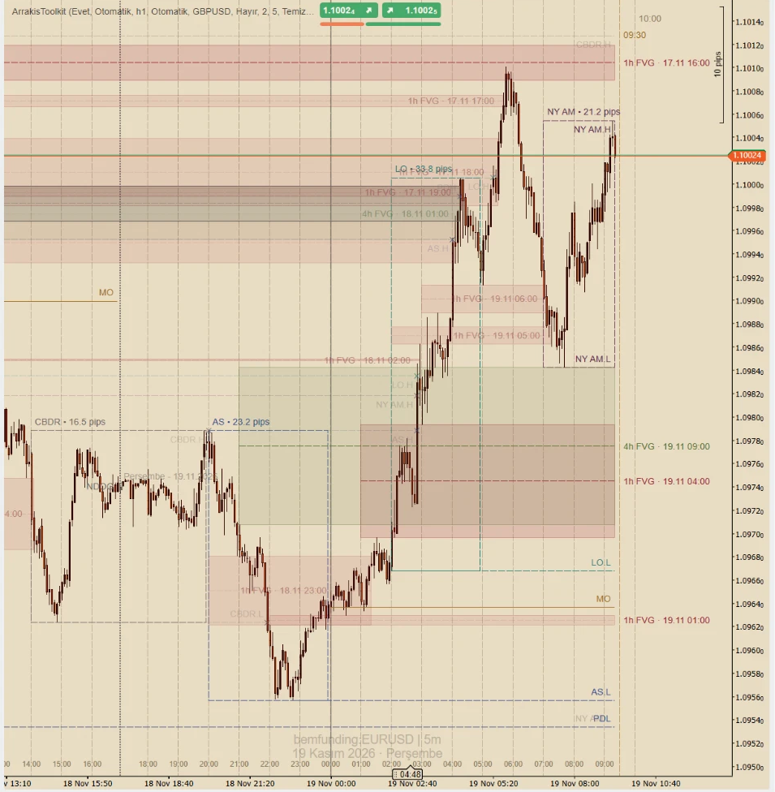

# Arrakis Toolkit — cTrader

**[Türkçe](#türkçe) · [English](#english)**

[Arrakis Toolkit](https://github.com/omeryagci/arrakis-toolkit-tradingview) TradingView indikatörünün cTrader sürümü. C# ile, cTrader Automate için yazıldı.
The cTrader version of the [Arrakis Toolkit](https://github.com/omeryagci/arrakis-toolkit-tradingview) TradingView indicator, written in C# for cTrader Automate.

> **TradingView** kullanıyorsan: [arrakis-toolkit-tradingview](https://github.com/omeryagci/arrakis-toolkit-tradingview)
>
> Using **TradingView**? See [arrakis-toolkit-tradingview](https://github.com/omeryagci/arrakis-toolkit-tradingview)



---

## Türkçe

### Ne yapar?

Gün içi işlemlerde baktığım seviyeleri ve zamanları tek göstergede toplar. Bütün saatler New York saatine göredir.

- **Killzone kutuları:** AS 20:00–00:00, LO 02:00–05:00, NY AM ve CBDR 14:00–20:00. NY AM saati sembole göre seçilir: forex'te 07:00–10:00, endekslerde 08:30–11:00. Kutuların high ve low seviyeleri fitil değene kadar sağa uzar.
- **Seviyeler:** PDH/PDL, PWH/PWL, PMH/PML. Alınan seviye soluklaşır ve değdiği yere ✕ konur.
- **Açılış boşlukları:** NWOG ve NDOG.
- **Midnight Open:** 00:00 açılışı, 17:00'ye kadar.
- **FVG'ler:** 1m'den 1M'ye kadar birden çok zaman dilimi. Etikette zaman dilimi ve FVG'nin kesinleştiği an yazar.
- **SMT:** Üst zaman diliminde karşı sembolle uyumsuzluk. Örneğin EURUSD↔GBPUSD, US100↔US500, XAUUSD↔XAGUSD.
- **Ayırıcılar:** Saatlik, günlük ve haftalık ayırıcılar, 09:30 çizgisi ve ekstra ayırıcılar. Gelecekteki ayırıcılar grafiğin sağında görünür.
- **Watermark:** Sembol, zaman dilimi ve tarih.
- **Görünüm:** Temiz ya da Tam. Temiz görünüm eski çizimleri siler değil, soluklaştırır.

### Güvenlik

Bu gösterge **sadece çizim yapar**. Kodda emir açan, pozisyon kapatan ya da değiştiren, hesapla işlem yapan hiçbir çağrı yoktur. Gösterge hiçbir izin istemez (`AccessRights.None`): internet, dosya ya da başka bir erişimi yoktur. Kaynak kodun tamamı bu repoda; kurmadan önce kendin de kontrol edebilirsin.

### Kurulum

**Hazır dosyayla:**

1. [`ArrakisToolkit.algo`](ArrakisToolkit.algo) dosyasını indir.
2. Dosyaya çift tıkla; cTrader kurmak isteyip istemediğini sorar, onayla.
3. cTrader'da bir grafik aç, araç çubuğundaki **Indicators** düğmesinden **Custom** bölümüne gir ve **ArrakisToolkit**'i seç.

**Kaynaktan derleyerek:**

[.NET SDK](https://dotnet.microsoft.com/download) gerekir.

```
cd ArrakisToolkit
dotnet build -c Release
```

Çıkan `.algo` dosyası `bin/Release/net6.0/` klasöründedir. cTrader.Automate paketi dosyayı ayrıca `Belgeler\cAlgo\Sources\Indicators` klasörüne de kopyalar.

Renkler, krem arka planlı bir "Dune" grafik temasına göre seçildi: arka plan `#E9DCC3`, ızgara `#D8C7A6`, yükselen mum `#2E0602`, düşen mum `#C93800`, kenar ve fitiller `#2E0602`. Bunları cTrader'ın grafik ayarlarından girip şablon olarak kaydedebilirsin.

### TradingView sürümünden farkları

- Gün, hafta ve ay, broker'ın kendi günlük, haftalık ve aylık mumlarından alınır.
- FVG'lerin en fazla uzama süresi gün olarak girilir; 0 sınırsız demektir.
- Ekstra ayırıcılarda günler virgülle yazılır, örneğin `Pzt,Sal,Çar`.
- Saatlik ve günlük ayırıcılarda her türün en fazla 600 kaydı tutulur, böylece cTrader yavaşlamaz.
- Watermark'taki "Borsa" seçeneği broker adını yazar.
- TradingView sürümündeki üst zaman dilimi mum grafiği bu sürümde yok.

### Notlar ve sınırlar

- Bu kişisel bir araçtır; yatırım tavsiyesi değildir.
- cTrader Desktop 5.10'da forex grafiklerinde denendi, ama az test edildi. Sorun görürsen issue açabilirsin.

---

## English

### What it does

It gathers the levels and times I watch for intraday trading into one indicator. All times are New York time.

- **Killzone boxes:** AS 20:00–00:00, LO 02:00–05:00, NY AM and CBDR 14:00–20:00. NY AM hours follow the symbol: 07:00–10:00 on forex, 08:30–11:00 on indices. Each box's high and low extend right until a wick touches them.
- **Levels:** PDH/PDL, PWH/PWL, PMH/PML. A taken level fades and gets a ✕ where it was touched.
- **Opening gaps:** NWOG and NDOG.
- **Midnight Open:** the 00:00 open, drawn until 17:00.
- **FVGs:** many timeframes from 1m to 1M. The label shows the timeframe and when the FVG was confirmed.
- **SMT:** divergence against a counterpart symbol on a higher timeframe, e.g. EURUSD↔GBPUSD, US100↔US500, XAUUSD↔XAGUSD.
- **Separators:** hourly, daily and weekly separators, a 09:30 line and extra separators. Upcoming separators show on the right of the chart.
- **Watermark:** symbol, timeframe and date.
- **View:** Clean or Full. The Clean view fades old drawings instead of removing them.

### Safety

This indicator **only draws**. The code has no call that opens, closes or modifies orders or positions, or acts on the account. It requests no permissions (`AccessRights.None`): no internet, file or other access. The full source is in this repo, so you can check it yourself before installing.

### Installation

**Ready-made file:**

1. Download [`ArrakisToolkit.algo`](ArrakisToolkit.algo).
2. Double-click it and confirm when cTrader asks to install it.
3. Open a chart in cTrader, go to **Indicators → Custom** on the toolbar and pick **ArrakisToolkit**.

**Build from source:**

Requires the [.NET SDK](https://dotnet.microsoft.com/download).

```
cd ArrakisToolkit
dotnet build -c Release
```

The `.algo` file lands in `bin/Release/net6.0/`. The cTrader.Automate package also copies it to `Documents\cAlgo\Sources\Indicators`.

The colors are chosen for a cream "Dune" chart theme: background `#E9DCC3`, grid `#D8C7A6`, up candle `#2E0602`, down candle `#C93800`, borders and wicks `#2E0602`. You can set these in cTrader's chart settings and save them as a template.

### Differences from the TradingView version

- Day, week and month come from the broker's own daily, weekly and monthly bars.
- The maximum FVG extension is set in days; 0 means unlimited.
- Extra separator days are a comma list, e.g. `Pzt,Sal,Çar` (Mon, Tue, Wed in Turkish).
- Hourly and daily separators keep at most 600 records per type so cTrader stays fast.
- The watermark's "Borsa" (exchange) option shows the broker name.
- The higher-timeframe candle chart from the TradingView version is not included.
- Settings and labels are in Turkish.

### Notes and limits

- This is a personal tool, not investment advice.
- Tried on cTrader Desktop 5.10 on forex charts, but lightly tested. If you find a problem, please open an issue.

---

MIT License · © 2026 Ömer YAĞCI
